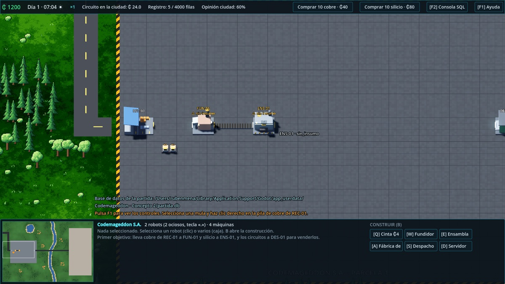
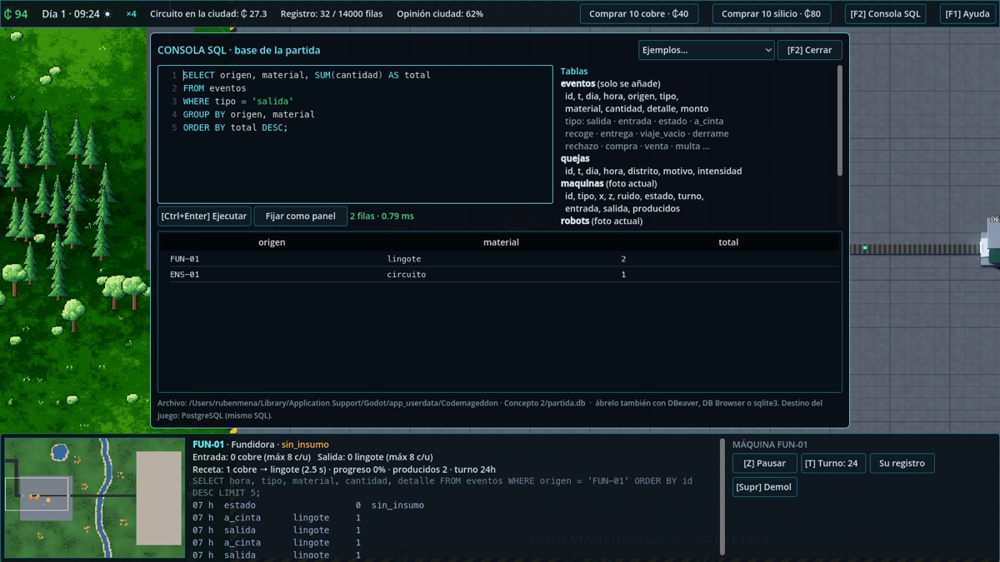
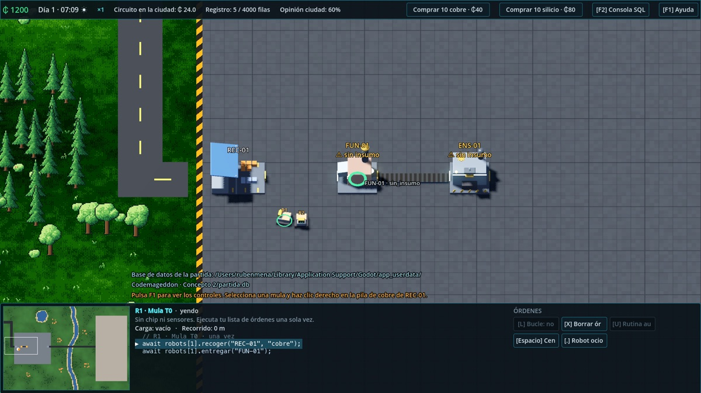
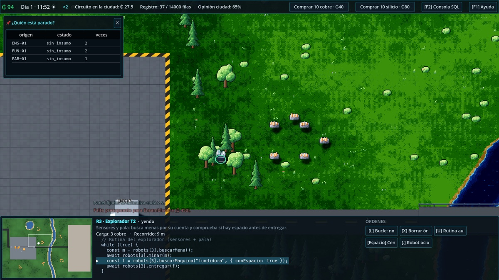
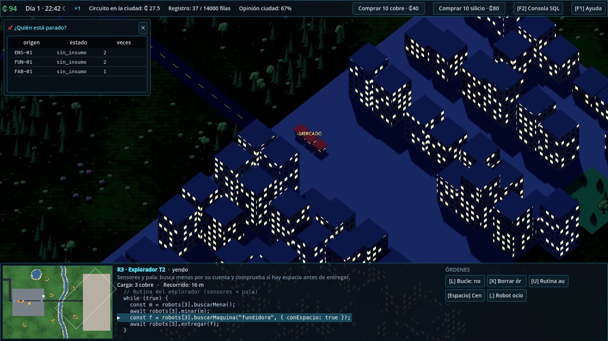

# Codemageddon · Concepto 2 (Godot 4.7)

Primer prototipo en Godot. Toma el feedback sobre el [Concepto 1](../Concepto1/README.md):

- Un mapa grande con la fábrica, una zona salvaje y la ciudad.
- Controles al estilo Age of Empires II.
- Construcción de máquinas y cintas.
- Materia prima que se compra y llega en camión.
- Robots por niveles.
- Máquinas que registran todo en una base de datos.
- Una ciudad que compra, se queja, protesta y audita.
- **Programas en JavaScript** que los robots ejecutan y **PostgreSQL** real, en escritorio y en la web.

**Demo web:** **https://codemageddon-demo.vercel.app** (se publica desde `demo/` en cada push a `main`).



## Abrirlo

Con Godot 4.7 en `/Applications`, abre la carpeta `Concepto2` como proyecto y pulsa ▶. O, desde la terminal:

```bash
/Applications/Godot.app/Contents/MacOS/Godot --path Concepto2
```

La partida empieza con la ayuda abierta (F1) y un panel de **objetivos** guía la demo. Las capturas de esta página las genera el propio juego con un guion de pruebas (ver «Pruebas»).

Para PostgreSQL y los programas JS en escritorio hace falta Node.js 20 o superior y, una vez:

```bash
cd Concepto2/servicio && npm install
```

Sin Node el juego funciona igual con SQLite y sin programas.

## Decisiones de tecnología

| Tema | Hoy | Destino | Cómo se evita perder algo al migrar |
| --- | --- | --- | --- |
| Base de datos | **PostgreSQL 18** vía [PGlite](https://pglite.dev) (Postgres compilado a WASM): en escritorio dentro del servicio Node, en la web dentro del navegador. Respaldo: SQLite ([godot-sqlite](https://github.com/2shady4u/godot-sqlite) v4.9) si no hay Node. | PostgreSQL | Todo el SQL del juego usa el subconjunto común de los dos motores. Las diferencias están aisladas en `scripts/db/base_datos.gd` y en el token `{ID}` de `datos/esquema.sql`. En escritorio la base también escucha el protocolo de Postgres en `127.0.0.1:5433` (usuario `postgres`), para psql o DBeaver. |
| Código del jugador | **JavaScript real**: un `worker_thread` de Node por robot (escritorio) o un Web Worker (web), con la misma API. | JavaScript | La API (`yo.recoger("REC-01", "cobre")`, `maquinas["FUN-01"].espacio("cobre")`, `await db.query(...)`…) es igual en los dos runtimes: `servicio/runtime_robot.mjs` y `servicio/web/servicio_web.js`. |
| Renderizador | Compatibility (WebGL 2 / OpenGL) | Web + escritorio | El mismo que recomienda el GDD para Netlify y Steam. |

La base es **registro y proyección**: borrar o editar filas no crea ni destruye material.

## Cómo se juega (y qué enseña)

**El arranque.** Tienes un terreno, ₵ 1200, dos *mulas* T0 sin chip y una minilínea (REC-01 → FUN-01 → cinta → ENS-01 … DES-01). El cobre y el silicio se compran desde la barra superior y llegan en camión. Los circuitos se venden en el mercado de la ciudad, al otro lado del río.

**Robots por niveles = conceptos por niveles.**

| Nivel | Qué puede hacer | Concepto |
| --- | --- | --- |
| T0 Mula | Ejecuta **una vez** la lista de órdenes que le das con clics | Secuencia: tus clics ya son el programa (se ve en el panel) |
| T1 Operario (con chip) | `L` repite la lista en bucle | Bucles |
| T2 Explorador (sensores y pala) | `U` activa una rutina propia: busca menas, mina, y **comprueba si hay espacio** antes de entregar | Condiciones, funciones y sensores |

Comprar o extraer: el cobre comprado es caro pero inmediato. Las menas de la zona salvaje son gratis, pero exigen fabricar exploradores.

**Programas (tecla J).** Con un robot T1 o T2 seleccionado, J abre su editor:

- **Plantillas:**
  - bucle básico,
  - condiciones sin derrames,
  - monitoreo con SQL,
  - funciones,
  - explorador.
- **«Desde mis clics»** convierte la lista de órdenes que diste con el ratón en código.
- **Órdenes:** son `await` que duran tiempo de juego (con el juego en pausa, el programa espera) y devuelven `"ok"`, `"viaje_vacio"`, `"derrame"`…
- **Ejecución y errores:** la línea en curso se ilumina, los errores marcan su línea, y un bucle sin `await` se detiene a los 3 s con una explicación.
- **Control manual:** dar una orden con el ratón detiene el programa.
- **Registro:** `log()` escribe en la consola del robot y en la tabla `eventos`.
- **SQL dentro del programa:** `await db.query(...)` consulta la base, así que un programa puede decidir según el monitoreo.

El mundo arranca con un Operario T1 (R3) para poder programar desde el principio.

**Errores físicos legibles (GDD §5).**

- Recoger en un sitio vacío es un `viaje_vacio`.
- Entregar en una entrada llena hace que el material caiga al suelo (`derrame`, recuperable con clic derecho).
- Una máquina que no usa ese material lo rechaza (`rechazo`).
- Las mulas derraman; el explorador espera, porque tiene sensor.

**Datos y monitoreo.**

- Cada máquina tiene un ID estable y registra en `eventos` sus entradas, salidas, estados (`sin_insumo`, `salida_llena`…) y lo que pasa por las cintas.
- El HUD muestra poco a propósito. Escribes una consulta (F2) y la **fijas como panel**; así el jugador construye su propio tablero de monitoreo.
- Al seleccionar una máquina, el panel muestra sus últimos eventos *junto con la consulta SQL que los produce*.
- La capacidad del registro es limitada. Los servidores la amplían; si se llena, el juego borra los eventos más antiguos (retención) y avisa.
- Hay ejemplos de `GROUP BY`, `JOIN`, `CASE`, índices y retención manual.
- En escritorio, la base se puede abrir con psql o DBeaver mientras juegas (`127.0.0.1:5433`, usuario `postgres`).



**La ciudad (logit anidado, familia GEV).** Cada hora simulada, una muestra de vecinos de cada distrito elige entre `comprar · ignorar · {quejarse · protestar}`. Las dos últimas comparten un nido «político» (λ = 0,6). Las utilidades dependen de:

- el precio,
- la opinión sobre la empresa,
- el humo y el ruido de las máquinas (el ruido pesa ×2,5 de noche),
- el tráfico de camiones.

El jugador no ve las utilidades: ve la tabla `quejas` y tiene que **descubrir la causa con SQL** (p. ej., el Norte se queja de humo y el Centro de ruido nocturno). Las consecuencias:

- **Precio:** el precio del circuito sube o baja con la intención de compra.
- **Bloqueo:** si el Centro protesta, corta la carretera dos horas y los camiones esperan (ataque físico).
- **Sabotaje:** si el Norte protesta mucho, puede averiar una máquina, que se repara con un robot (clic derecho).
- **Ordenanza:** con muchas quejas de ruido nocturno, el ayuntamiento impone el **silencio nocturno** (ataque político). Desde ese momento, cada mañana a las 06:00 **ejecuta una consulta SQL sobre tu tabla `eventos`** y multa a las máquinas ruidosas que produjeron de noche. La consulta se muestra en pantalla. Se cumple poniendo esas máquinas en turno «diurno» (tecla T). Borrar los eventos también evitaría la multa: es una tentación deliberada para una futura mecánica de integridad de datos.

## Laboratorio de jugabilidad

En desarrollo, **F12** abre las devtools: pausa y pasos, creación de entidades, inventarios, ajustes por tipo e instancia, escenarios JSON, eventos programados y ranuras reproducibles. Consulta [la guía y el formato](docs/DEVTOOLS.md). En una exportación de lanzamiento se habilitan explícitamente con `--dev`.

## Controles

| Ratón | |
| --- | --- |
| Clic izquierdo | Seleccionar. Arrastrar = caja; doble clic = todos los del mismo nivel en pantalla; Shift = añadir |
| Clic derecho | Orden según el objetivo, al soltar: suelo = ir; máquina = recoger o entregar (según lleve carga); pila de REC-01 = el material de ese lado del andén; mena = minar; máquina averiada = reparar; material caído = recoger |
| **Arrastrar con el clic derecho** | **Desplazar la cámara**: el suelo sigue al cursor y no se da ninguna orden. También en modo construcción |
| Shift + clic derecho | Encolar (la lista es el programa del robot) |
| Rueda | Zoom en pasos enteros de píxel por metro, hacia el cursor |
| **Rueda pulsada** | **Orbitar** (giro libre que se ajusta a 45° al soltar, para que la luz dibujada de los sprites no quede en ángulos arbitrarios) |
| Minimapa | Clic o arrastre para mover la cámara |

| Teclado | |
| --- | --- |
| Flechas / WASD / bordes | Desplazar · Q/E girar 45° |
| B → Q W E / A S D | Construir: cinta, fundidora, ensambladora / fábrica de robots, despacho, servidor |
| R · Shift · clic derecho/Esc | Girar · colocar varias · cancelar |
| Supr · Ctrl+Z | Demoler (50 %) · deshacer la última obra si sigue en construcción (100 %) |
| Ctrl+1…9 · 1…9 | Crear grupo · seleccionarlo (dos veces = centrar) |
| . · H · Espacio | Robot ocioso · fábrica · centrar en la selección |
| L · X · U | Bucle · borrar órdenes · rutina automática (robots) |
| Z · T · V | Pausar máquina · turno diurno · enviar camión (despacho) |
| P · + / − | Pausa · velocidad (×1, ×2, ×4, ×8) |
| J | Editor del programa JavaScript del robot seleccionado |
| F1 · F2 | Ayuda · consola SQL |

Las **cintas** entregan material en la **entrada** de una máquina y reciben de su **salida**. Cada máquina lo indica con flechas flotantes: **verde** = entrada (apunta a la máquina), **roja** = salida (apunta hacia fuera). Parpadean mientras ninguna cinta las conecta y quedan tenues cuando ya hay una. El fantasma de construcción muestra las mismas flechas. El arrastre de la cinta traza una L: el eje con más recorrido va primero.



## Estilo visual

Se mantiene la regla del Concepto 1: **lo vivo se dibuja, lo fabricado se modela, y el robot está entre ambos**.

- **Terreno:** un shader calcula cada píxel a 16 px/m a partir de un mapa lógico de 1 m. Las orillas son orgánicas gracias al ruido y al tramado Bayer, y las orugas desgastan el pasto y la fundidora lo seca.
- **Flora y menas:** sprites en un MultiMesh que miran a la cámara y quedan a la profundidad de su base.
- **Fábrica, camiones y ciudad:** modelos 3D. Las ventanas de la ciudad se encienden de noche.
- **Robots:** volumen 3D con la cara-pantalla en pixel art y su ID encima (`R1`).

| Explorador T2 | Noche |
| --- | --- |
|  |  |

Los modelos se generan con `tools/blender/modelos.py`, ya sea sin ventana o en tu sesión abierta de Blender (`vista_previa()` crea la escena «Codemageddon»):

```bash
/Applications/Blender.app/Contents/MacOS/Blender -b --factory-startup --python tools/blender/modelos.py -- assets/modelos
```

## Arquitectura

```
scripts/config.gd          constantes de diseño y balance
scripts/sim/               simulación pura a 20 Hz (sin nodos): rejilla + A*, máquinas, cintas,
                           robots, camiones, ciudad (logit anidado)
scripts/db/base_datos.gd   adaptador PostgreSQL/SQLite: volcado por lotes, proyecciones, retención,
                           consultas síncronas (escritorio) y asíncronas (todas las plataformas)
scripts/servicio/          conexión con el servicio: Node por TCP (escritorio) o JavaScriptBridge (web)
servicio/main.mjs          servicio de escritorio: PGlite + runtime JS (worker_threads)
servicio/runtime_robot.mjs API del juego para los programas (escritorio)
servicio/web/              servicio web: PGlite en el navegador + Web Workers (misma API)
datos/esquema.sql          esquema en el subconjunto común SQLite/PostgreSQL
scripts/mundo/pixel.gd     generadores de pixel art (portados del Concepto 1) y caras de robot
scripts/vista/             terreno, flora, ciudad, máquinas GLB, robots, cámara RTS
scripts/ui/                control AoE2, HUD con minimapa y objetivos, consola SQL, editor de programas
scripts/principal.gd       bucle: pasos fijos con velocidad, interpolación, base de datos, auditorías
shaders/                   terreno, sprites, losa, cintas, edificios
tools/blender/modelos.py   familia paramétrica de modelos (10 GLB)
tools/exportar_web.sh      exporta la demo web a ../demo (Godot + servicio web + PGlite)
docs/JEV.md                análisis de Jev (TypeSafe AI) para las decisiones del juego
pruebas/                   pruebas sin ventana y guiones con capturas
```

La simulación publica tres colas (`registro`, `quejas`, `avisos`) que vacían la presentación y la base de datos. La auditoría de la ciudad es una consulta que la simulación pide y `principal.gd` ejecuta sobre la base real.

## Pruebas

```bash
cd Concepto2
G=/Applications/Godot.app/Contents/MacOS/Godot
$G --headless --path . -s pruebas/prueba_sim.gd       # línea inicial + consultas
$G --headless --path . -s pruebas/prueba_larga.gd     # 3 días: ventas, quejas, bloqueo, ordenanza, auditoría
$G --headless --path . -s pruebas/prueba_determinismo.gd  # diario de comandos: dos corridas, replay y huella
$G --path . -- --guion=res://pruebas/guion_controles.gd   # 16 comprobaciones de controles por eventos reales
$G --path . -- --guion=res://pruebas/guion_programas.gd   # 10 comprobaciones de JS + PostgreSQL de punta a punta
$G --path . -- --guion=res://pruebas/guion_capturas.gd    # capturas en pruebas/capturas/
```

Último resultado (22 de octubre de 2026):

- `guion_controles`: 0 fallos en 16 comprobaciones (incluye arrastre con el clic derecho, flechas de puertos y atajos de máquina que pasan por la cola de comandos).
- `prueba_determinismo`: 0 fallos. 13 comandos repartidos en 6000 pasos, 26 puntos de control, replay del diario (también serializado) y alcance de la huella.
- `guion_programas`: 0 fallos en 10 comprobaciones:
  - Postgres 18.3.
  - Un programa JS que entrega cobre.
  - Pausa.
  - `db.query` dentro del programa.
  - Error de sintaxis en su línea.
  - Vigilante de bucles sin `await`.
  - Control manual que detiene el programa.
- Web (Chromium):
  - PostgreSQL arranca en el navegador.
  - Un programa JS se ejecuta en un Web Worker con la línea resaltada.
  - El primer objetivo se completa con el ratón.
- `prueba_larga`:
  - 288 lingotes y 129 circuitos.
  - 12 ventas.
  - 2 bloqueos.
  - Ordenanza en vigor y 3 auditorías con multa.
  - 66 unidades minadas por el explorador.

## Límites conocidos

- **JavaScript en escritorio depende de Node:** para distribuir en Steam habrá que empaquetar Node (o pasar el mismo protocolo a QuickJS). Los programas no son un sandbox de seguridad para código ajeno (GDD §10): son un entorno educativo.
- **PostgreSQL en memoria:** la base se crea vacía en cada partida; no hay guardado todavía.
- **Web:** la demo pesa unos 67 MB (Godot con extensiones + PGlite). Solo se probó en Chromium.
- **Balance sin ajustar:** precios, ruido, quejas y tiempos son de primera pasada. Las mulas derraman mucho si se usan en bucle hacia máquinas llenas (intencional, pero puede frustrar).
- **Movimiento:** solo hay órdenes por destino con A*. La variante «por pasos» del GDD queda pendiente.
- **Rotación y sprites:** con la cámara girada, el sombreado dibujado de los sprites no coincide con el sol. El ajuste a 45° lo limita.
- **Datos:** el registro no tiene integridad (se pueden borrar eventos para esquivar la auditoría). Puede ser una mecánica futura: sellos encadenados, auditoría de huecos.
